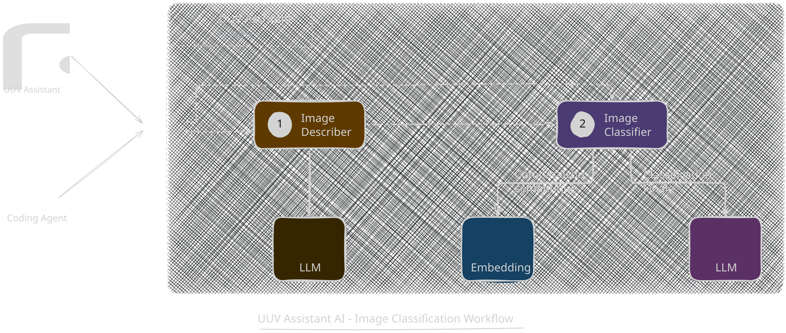

import Tabs from '@theme/Tabs';
import TabItem from '@theme/TabItem';

# UUV Assistant

## Fonctionnalités

### Navigation à la souris

L'assistant permet de générer des phrases UUV pour des comportements à la souris.

Les phrases permettent de vérifier la présence d'élements dans le DOM HTML, de faire des actions de types click à la souris, ou encore de mettre le focus souris sur un élément.

Si les phrases n'ont ni un nom ou role accessible, une alerte est remontée dans la gouttière de résultat.

### Navigation au clavier

L'assistant permet de générer des phrases UUV pour des comportements au clavier.

Les phrases permettent de vérifier l'ordre réel de navigation au clavier et génère les phrases de vérifications en conséquence.

### Classification d'images avec IA
L'assistant classe les images de la page en Décorative ou Informative grâce à l'API de classification d'images du serveur MCP, et seules les images informatives sont prises en compte lors de la génération des scénarios de test.




## Démo en ligne

<a href="https://uuv-assistant.vercel.app/">
    La démo en ligne est disponible ici.
</a>

## Installation
### Paquet NPM
Lancer la commande suivante :

<Tabs>
<TabItem value="npm" label="Npm">

```shell
npm install --save-dev @uuv/assistant
```

</TabItem>
<TabItem value="Yarn" label="Yarn">

```shell
yarn add -D @uuv/assistant
```

</TabItem>
</Tabs>

### Desktop executable
1. Télécharger l'exécutable à l'aide du bouton suivant :

   <a href="https://github.com/e2e-test-quest/uuv/releases/latest"></a>
2. Décompresser le fichier zip

## Lancement
### Paquet NPM
```shell
npx uuv-assistant --targetUrl=<url cible>
```

| Nom                  | Description                                                                                                   | Exemple                               |
|----------------------|---------------------------------------------------------------------------------------------------------------|---------------------------------------|
| `targetUrl`          | Target website url                                                                                            | https://e2e-test-quest.github.io/uuv/ |

### Desktop executable
Exécuter le fichier `uuv-assistant.exe` depuis le dossier décompressé


